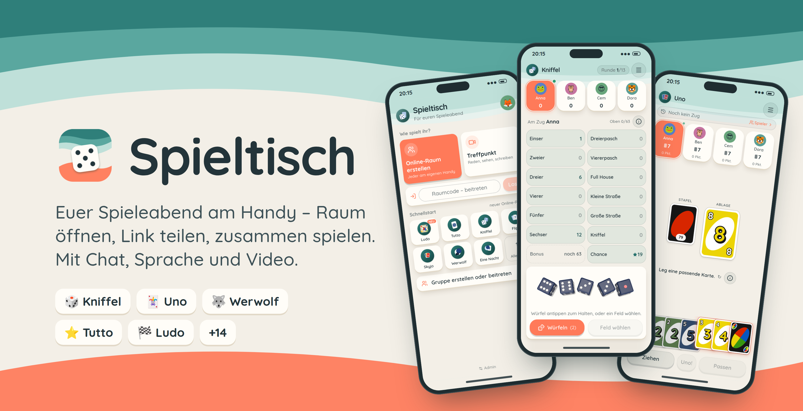
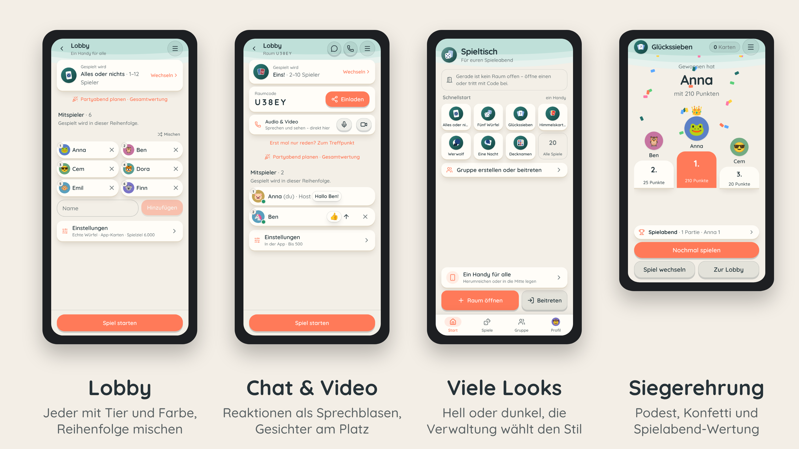

# Spieltisch

Die Spielesammlung für den Spieleabend am Handy: Raum öffnen, Link teilen, zusammen spielen – jeder am eigenen Handy, mit Chat, Sprache und Video direkt am Tisch.

**Live:** https://spieltisch.bjoern-ef9.workers.dev/

<p align="center"></p>

## Funktionen

- **Wie eine App** – Tab-Leiste (Start, Spiele, Gruppe, Profil), Begrüßung mit Papierschnitt-Animation, Willkommen mit Rundgang für neue Geräte, direkt installierbar.
- **Online-Räume** – Raumcode und PIN, alle sehen live denselben Stand. Der Server führt, so bleibt alles synchron, auch nach Funklöchern.
- **Räume auf einen Blick** – Der Start zeigt eigene und offene Räume, Gruppe zuerst. Jeder Raum ist öffentlich, nur für die Gruppe oder privat, auf Wunsch mit Anklopfen; leere Räume bleiben 1 Stunde bis 1 Woche, Dauerräume legt der Admin an.
- **Chat, Sprache, Video** – Text-Chat mit Reaktionen als Sprechblasen, Sprach- und Videochat mit den Gesichtern direkt in der Spielerleiste. Jeder Raum ist zugleich **Treffpunkt**: reden ohne Spiel, spielen ohne Video – beides geht.
- **Echte 3D-Würfel** – Die Würfel fliegen mit echter Physik über den Bildschirm und landen gut lesbar in der Ablage. Das Ergebnis kommt immer aus fairem Zufall.
- **Für jede Runde passend** – Alle Spieler in einer Zeile, kein Scrollen, auch auf kleinen Handys. Jedes Spiel geht in der App oder mit echtem Material am Tisch (die App ist dann Punkteblock, Schlüsselkarte oder Erzähler).
- **14 Looks** – Der Admin wählt den Stil, hell oder dunkel stellt jeder selbst ein.
- **Rund um die Partie** – Siegerehrung mit Podium, Spielabend-Wertung, Gruppen mit Bestenliste, Profile mit Statistik.
- **Verwaltung** – Eigener Tab auf Admin-Geräten: Live-Räume mit Eingriffen und unsichtbarem Zuschauen, Statistik mit Spitzenzeiten, Freigaben und Standards je Spiel, Status mit Versionsabgleich und ein Entwickler-Modus mit Testspielern.
- **Als App installierbar** – eigenes Icon und Vorschaubild beim Teilen. Optional einschaltbar: „Ein Handy für alle“ und Offline-Nutzung.

<p align="center"></p>

## Spiele

| Kategorie | Spiele |
| --- | --- |
| Würfel | Alles oder nichts, Fünf Würfel, Mäxchen |
| Karten | Eins!, Mau-Mau, Stapelbau, Zehn Phasen, Himmelskarten, Glückssieben, Fischen, Hellseher |
| Party & Rollen | Werwolf (die App erzählt und liest vor), Eine Nacht, Decknamen, Spion, Schamlos, Stirnraten (Handy an die Stirn: klassisch, Teams, Bombe, Hochstapler), Zeichnen & Raten (malen am Handy, raten per Rufen oder Tippen) |
| Brett | Ludo, Vier in einer Reihe, Mühle, Dame |

## Loslegen

Voraussetzung: Node.js 22 (siehe `.nvmrc`).

```bash
npm install
npm run dev            # http://localhost:5173 – Worker und Durable Objects laufen lokal mit
npm run dev -- --host  # zum Testen mit dem Handy im selben WLAN
```

| Befehl | Zweck |
| --- | --- |
| `npm run build` | Typprüfung und Produktions-Build |
| `npm test` | Unit-Tests (Vitest) |
| `npm run test:e2e` | Handy-Tests im Browser (Playwright) |
| `npm run deploy` | Build und Deploy per Wrangler |

Jeder Push auf `main` wird von Cloudflare automatisch gebaut und ausgeliefert.

## Technik

React 19, TypeScript, Vite, Tailwind CSS v4 und shadcn/ui im Browser; Cloudflare Workers mit Durable Objects auf dem Server; three.js und cannon-es für die Würfel; Cloudflare Realtime für Sprache und Video. Läuft im kostenlosen Cloudflare-Tarif.

## Dokumentation

- [Konzept](docs/konzept.md) – Leitbild, App-Aufbau, Räume, Umsetzungsplan, Ausblick auf native Apps
- [Entwicklung](docs/entwicklung.md) – Architektur, Grundprinzipien, ein neues Spiel hinzufügen, Tests
- [Betrieb](docs/betrieb.md) – Deployment, Secrets, Sicherheit, Datenhaltung
- [Roadmap](docs/roadmap.md) – geplante Spiele und offene Punkte
